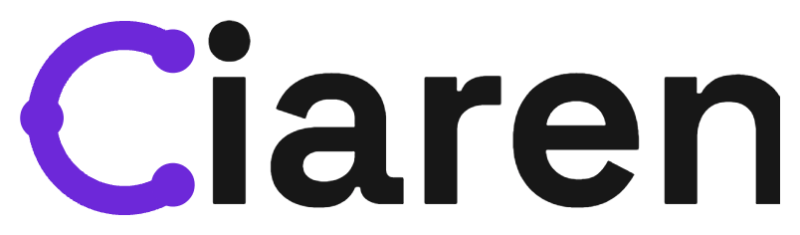
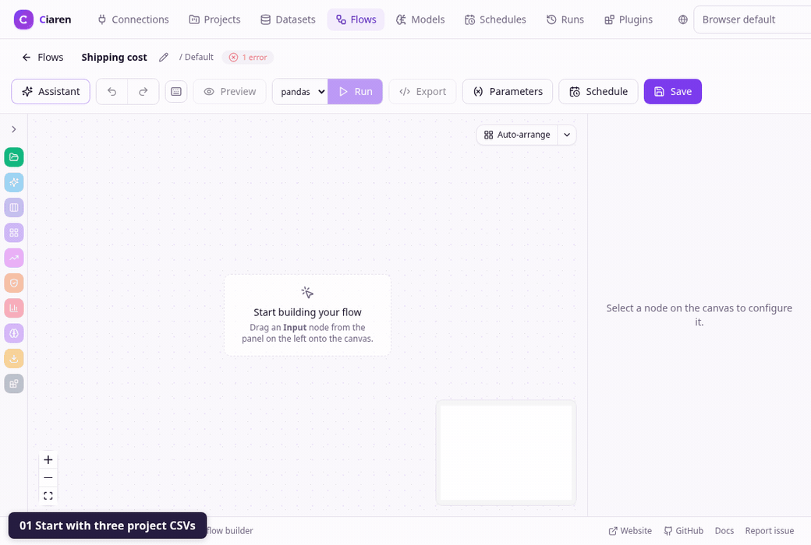
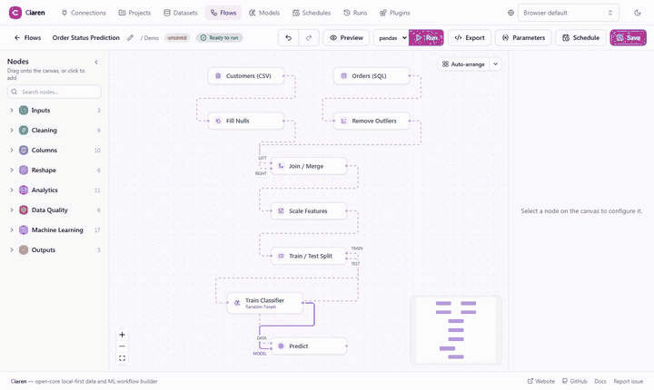
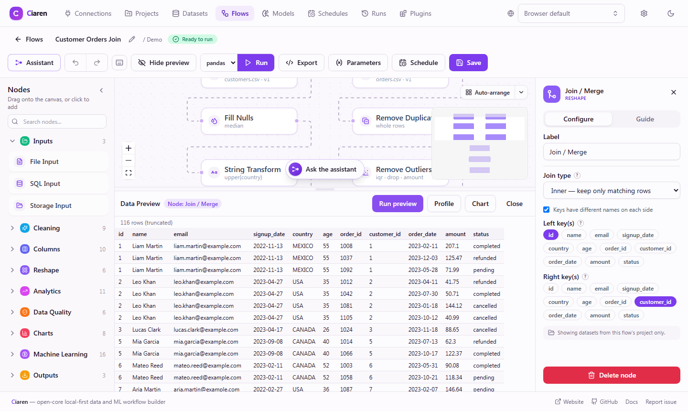

<p align="center">
  
</p>

<h3 align="center">
  Describe a data or ML pipeline in plain language. Review the flow Ciaren proposes, edit it on the canvas, run it locally and export pandas or Polars code.
</h3>

<p align="center">
  Open-source, local-first visual ETL for Python. The AI flow assistant (bring your own provider API key) drafts complete flows: inputs, cleaning, joins, reshaping, charts, and ML training, cross-validation and evaluation.<br>
  Nothing is saved until you approve it, and you can edit every node by hand at any time. Building manually needs no API key.
</p>

<p align="center">
  <a href="docs/guide/flow-assistant-quick-start.md">AI quick start</a>
  · <a href="https://ciaren.com/docs/latest/guide/quick-start">Manual quick start</a>
  · <a href="docs/guide/flow-assistant.md">Assistant guide</a>
  · <a href="https://ciaren.com/docs/latest">Docs</a>
  · <a href="https://ciaren.com/docs/latest/plugins/overview">Plugins</a>
  · <a href="https://github.com/ciaren-labs/Ciaren/discussions">Discussions</a>
  · <a href="CONTRIBUTING.md">Contributing</a>
  · <a href="https://github.com/ciaren-labs/Ciaren/issues?q=is%3Aissue+is%3Aopen+label%3A%22good+first+issue%22">Good first issues</a>
</p>

<p align="center">
  <a href="https://pypi.org/project/ciaren/"></a>
  <a href="https://github.com/ciaren-labs/Ciaren/actions/workflows/backend-tests.yml"></a>
  <a href="https://github.com/ciaren-labs/Ciaren/actions/workflows/frontend-tests.yml"></a>
  <a href="https://github.com/ciaren-labs/Ciaren/actions/workflows/docker.yml"></a>
  <a href="LICENSE"></a>
  <a href="backend/app/plugin_api/"></a>
  
  
  <a href="https://github.com/ciaren-labs/Ciaren/issues?q=is%3Aissue+is%3Aopen+label%3A%22good+first+issue%22"></a>
  <a href="https://github.com/ciaren-labs/Ciaren"></a>
</p>



The recording joins 80 synthetic orders to customers and products, learns shipping cost from distance and weight, and evaluates 16 held-out orders. The provider response is simulated. The joins, model fit and metrics run in the packaged application. [Try the shipping cost example](examples/shipping-regression/README.md).

> **Alpha software.** APIs, workflow formats, generated code, plugin interfaces and
> internal data models may change before `1.0.0`. Use Ciaren for learning,
> prototypes and controlled internal workflows before relying on it for critical
> production jobs.
>
> **The assistant is not in the published 0.3.1 release.** `pip install ciaren`
> and the Codespaces demo currently give you 0.3.1, which has the full manual
> editor but no **Assistant** button. To try the assistant, run a source checkout or
> the Docker build from `main` (see [Quickstart](#quickstart)).

## From a prompt to a running pipeline

1. **Describe.** Open a flow, choose **Assistant → Build**, and write the result you want in your own words, for example "join orders with customers, compute revenue per country and chart it" or "train a random forest with 5-fold cross validation and show feature importance". On an empty canvas, first pick the project dataset (and optionally a second one to join). On an existing flow, the assistant works from its input.
2. **Review.** The assistant looks up node settings in the installed catalog, reads column types, edits a working copy of the flow and validates it. A draft it could not finish checking within its limits is marked as not checked. You see the nodes, every changed setting and the connections.
3. **Apply and save.** Nothing changes until you choose **Apply and save**. A saved proposal is a normal flow, and **Activity** can preview and reverse a saved assistant change.
4. **Edit.** The result is ordinary nodes on the canvas. Change a setting, add a node or rewire anything by hand, exactly as in a flow you built yourself.
5. **Run and export.** Choose **Run** to execute locally with pandas or Polars. The assistant never runs a pipeline for you. Export the flow as standalone pandas, Polars or lazy Polars Python, or as a Jupyter notebook.

**What it can propose.** File inputs from your project's datasets and file outputs. Cleaning, joins and concatenation, group by, pivot, unpivot and window steps. Data-quality assertions and the eight chart nodes. Machine learning: split, scaling, encoding, feature selection, classifiers and regressors, training, clustering, predict, evaluate, cross-validate and feature importance. It can also **Diagnose** a failed run and propose a repair, and answer questions from the bundled guides with a source link.

**What it cannot do.** It does not write Python Transform nodes, SQL or cloud-storage connectors, plugin nodes or forecasting models, and it cannot change data connections, credentials or file paths. Add those in the editor. A request it cannot meet ends with an explanation instead of a proposal. Complete flows need a model with tool calling, which covers the listed OpenAI, Anthropic and DeepSeek models. The listed OpenCode models have no tool calling and handle only a few guided plans.

**Your key, your provider.** Add an API key under **Connections → Assistant API keys** for OpenAI, Anthropic, DeepSeek or OpenCode Console. Ciaren stores it in the OS keychain (`ciaren[keyring]`). By default the provider receives your request text, node types, wiring, column types and profile counts (rows, nulls, distinct values). Dataset rows are never sent, and column names are shared only when you opt in for a request. The provider can bill you for calls. Details are in the [assistant guide](docs/guide/flow-assistant.md).

Start with the [AI quick start](docs/guide/flow-assistant-quick-start.md), or read an assistant-built [Join diagnosis and reversal](docs/guide/flow-assistant.md#walkthrough-recover-a-missing-order). To drive Ciaren from your own agent, try the [read-only SDK example](docs/guide/external-agent.md).

## Or build it by hand

Ciaren is also a visual ETL tool on its own. You drag nodes onto a canvas to load, clean, join, validate and transform data, train lightweight machine-learning models, and schedule runs. Every node previews real data, and the flow exports to the pandas or Polars code you would write by hand, with no proprietary runtime.



Follow the [manual quick start](https://ciaren.com/docs/latest/guide/quick-start) with the seeded Demo project or your own CSV. No model API key is required, and connectors that reach external services may need their own credentials. To see exported code without installing Ciaren, [audit five orders against a product catalog](examples/orders-audit/README.md) in pandas or Polars, then import the same flow on the canvas.

## Why It Feels Different

| You get | Why it matters |
| --- | --- |
| **Prompt-to-flow assistant** | Describe a pipeline, review the proposed nodes and connections, then apply, edit and run them. Bring your own provider API key. |
| **Visual workflow building** | Design pipelines faster than writing every dataframe step by hand. |
| **Live node previews** | Inspect data samples and schema changes before running the full flow. |
| **Clean Python export** | Generate standalone pandas, Polars, or lazy Polars scripts you can review and run outside Ciaren. |
| **Local-first execution** | SQLite works out of the box, and your data does not need to leave your machine. |
| **Data engineering + ML** | Ingest, clean, validate, engineer features, train, evaluate, predict, and export from one canvas. |
| **Plugin-first architecture** | Add custom nodes, connectors, and ML model types outside core. Engine, exporter, and validator extension points are defined for later releases. |

Ciaren is not a hosted no-code black box. Every node maps to understandable
dataframe behavior, every run leaves inspectable results, and every flow can
become code.

## Quickstart

One install starts the API, scheduler and web UI. The wheel bundles the React
editor, so there is no separate frontend package.

| Route | Gets you | AI assistant |
| --- | --- | --- |
| `pip install ciaren` | Release 0.3.1 | Not included |
| GitHub Codespaces | Release 0.3.1 from PyPI | Not included |
| Docker from a `main` checkout | The current source | Included |
| Source checkout (below) | The current source | Included |

### Install From PyPI

```bash
python -m pip install --upgrade pip
python -m pip install ciaren
ciaren serve
```

Open `http://localhost:8055`, then open **Projects -> Demo**. The first start
seeds sample datasets and working example flows, so you can preview, run, and
export something real before uploading your own data.

For repeatable evaluation, pin the release version:

```bash
python -m pip install "ciaren==0.3.1"
```

### Try the manual editor in your browser

[](https://codespaces.new/ciaren-labs/Ciaren?quickstart=1)

Opens the Ciaren editor with the demo project in about two minutes, on your
free GitHub Codespaces hours. Nothing to install.

### Run With Docker

```bash
git clone https://github.com/ciaren-labs/Ciaren.git
cd Ciaren
docker compose up --build
```

Open `http://localhost:8055`. A container has no OS keychain, so give the
assistant its provider key through a server secret instead of the Connections
page. See [Deployment and credentials](docs/guide/flow-assistant.md#deployment-and-credentials).

### Run From Source

Use this path to try the assistant locally or to contribute to the backend,
frontend, docs, or plugin SDK. The [AI quick start](docs/guide/flow-assistant-quick-start.md)
shows the build that serves the editor from `ciaren serve` with the `[keyring]`
extra, so you can save a provider key on the Connections page.

Requirements: Python 3.12+, Git, and Node.js 22.22.2+ (22.x), 24.15.0+ (24.x), or 26+.
CI checks each supported minimum and the current Node 22 release.

```bash
git clone https://github.com/ciaren-labs/Ciaren.git
cd Ciaren/backend

python -m venv .venv
source .venv/bin/activate        # Windows: .venv\Scripts\activate

pip install -e .
ciaren serve
```

In a second terminal:

```bash
cd Ciaren/frontend
npm install
npm run dev
```

Open `http://localhost:5173` for the live development frontend. The backend API
and Swagger docs stay on `http://localhost:8055`.

## What You Can Build



- **Input and output:** CSV, TSV, Excel, Parquet, JSON/JSONL, text, SQL
  databases, S3, GCS, and Azure Blob.
- **Cleaning:** drop/fill nulls, remove duplicates, rename/select/drop columns,
  cast types, replace values.
- **Transformation:** filters, joins, group by, aggregate, calculated columns,
  maps, pivots, windows, sorting, sampling.
- **Data quality:** assert not-null, unique, value ranges, row count,
  expressions, and allowed values.
- **Machine learning:** split, train, cross-validate, predict, evaluate,
  feature engineering, importance, and MLflow tracking.
- **Operations:** run history, scheduling, REST API, CLI, webhook trigger, and
  Python SDK.

## Exported Code Is the Escape Hatch

Every flow exports to a standalone Python script — pandas, eager Polars, or
lazy Polars — so the visual pipeline never traps your logic.

A simple read -> clean -> aggregate -> write flow can export to code like this:

```python
import polars as pl

df_1 = pl.read_csv("sales.csv")
df_1 = df_1.drop_nulls(subset=["amount"])
df_1 = df_1.group_by(["region"]).agg([pl.col("amount").sum().alias("amount")])
df_1.write_csv("summary.csv")
```

The same flow can also export pandas or lazy Polars variants where supported,
and each variant can be downloaded as a Jupyter notebook (`.ipynb`). That makes Ciaren useful for prototyping, teaching, code review, and migration
from visual exploration into normal Python projects.

## How It Compares

| If you use… | Ciaren gives you… |
| --- | --- |
| **Jupyter notebooks or pandas scripts** | The same dataframe code, but built as a repeatable, previewable, schedulable flow. |
| **Visual ETL / data-prep tools** (for example KNIME, Alteryx, Orange) | A drag-and-drop canvas whose output is plain pandas or Polars Python, not a proprietary workflow format. |
| **Airflow, dbt, or Spark** | A lightweight, single-machine option for small and medium datasets — no cluster or warehouse to set up. Ciaren does not replace these tools at scale. |

Read the full [comparison with notebooks, orchestrators, and visual ETL tools](https://ciaren.com/docs/latest/guide/comparison).

## Built for Extension

Ciaren's open core stays focused on the shared workflow platform. Specialized
integrations should usually be plugins, not one-off patches to core.

| Extension point | Examples |
| --- | --- |
| **Nodes** | Custom transforms, validators, AI-assisted steps, domain-specific operations |
| **Connectors and storage** | Internal APIs, SaaS tools, warehouses, object stores, document databases |
| **Model providers** | Local models, scikit-learn estimators, organization-specific training logic |
| **Execution engines** | Alternative dataframe engines and future runtime targets |
| **Exporters** | Code targets, deployment bundles, validation reports |

Plugins can be packaged as `.ciarenplugin` files, signed, inspected, installed,
enabled, disabled, and distributed independently.

Start here:

- [Plugins Overview](https://ciaren.com/docs/latest/plugins/overview)
- [Build Your First Plugin](https://ciaren.com/docs/latest/plugins/first-plugin)
- [Plugin API Reference](https://ciaren.com/docs/latest/plugins/api-reference)

## Who It Is For

- **Data analysts:** clean, reshape, validate, and export datasets without
  writing every step by hand.
- **Data engineers:** prototype repeatable local pipelines, inspect generated
  code, then automate with CLI/API/SDK workflows.
- **Python learners:** see how visual dataframe operations become pandas and
  Polars code.
- **ML practitioners:** try lightweight ML flows with local MLflow tracking.
- **Plugin authors:** ship custom nodes, connectors, and ML model types
  without maintaining a fork.
- **Open-source contributors:** help polish the editor, execution engine,
  transformations, docs, tests, and plugin SDK.

## Documentation

- [AI quick start](docs/guide/flow-assistant-quick-start.md) - register a key,
  build a flow from a prompt, and reverse a saved change.
- [Flow assistant guide](docs/guide/flow-assistant.md) - what it can build,
  providers, privacy, limits, and activity history.
- [Installation](https://ciaren.com/docs/latest/guide/installation) - PyPI, Docker,
  source installs, extras, and troubleshooting.
- [Manual quick start](https://ciaren.com/docs/latest/guide/quick-start) - build
  your first flow by hand in five minutes.
- [Demo Project & Tutorials](https://ciaren.com/docs/latest/guide/demo-project) - walk
  through the seeded example flows.
- [Examples](https://ciaren.com/docs/latest/examples/sales-analysis) - end-to-end
  workflow walkthroughs.
- [Machine Learning Quick Start](https://ciaren.com/docs/latest/guide/ml-quickstart) -
  train and evaluate a model on the canvas.
- [Plugin Guide](https://ciaren.com/docs/latest/plugins/first-plugin) - build your
  first plugin.
- [Roadmap](https://ciaren.com/docs/latest/guide/roadmap)
- [Security](SECURITY.md)
- [Contributing](CONTRIBUTING.md)

## Optional Extras

The base install includes the core app, pandas, Polars, scikit-learn models,
MLflow tracking, and the bundled web UI.

Install extras only when you need specific drivers or optional model families:

```bash
python -m pip install "ciaren[postgres]"
python -m pip install "ciaren[s3]"
python -m pip install "ciaren[ml]"        # XGBoost and LightGBM choices
python -m pip install "ciaren[keyring]"   # recommended: store connection secrets in the OS keychain
python -m pip install "ciaren[signing]"   # plugin signing support
```

On a desktop install, `ciaren[keyring]` is the **recommended** way to hold
database and API secrets and the assistant's provider keys: the connection form
(and the `ciaren secret set` command) stores the value in your OS keychain — Windows Credential Manager,
macOS Keychain, or Secret Service on Linux — and the connection keeps only a
`keyring:NAME` reference. Ciaren never writes the secret to its database.
Without the extra, connections still work with environment-variable
(`env:`/`PG_PASSWORD`) or secret-file (`file:/run/secrets/...`) references.

The separate `ciaren-client` package is only for scripts that need to call a
running Ciaren server. It is not required to use the visual app.

## Contributing

Ciaren is early, and useful contributions are welcome: reproducible bugs,
example flows, docs improvements, transformation nodes, plugin SDK improvements,
frontend workflow polish, tests, and focused core fixes.

The open core is intentionally lightweight. New niche databases, SaaS products,
internal APIs, proprietary storage systems, and organization-specific model
logic should normally be built as plugins. If the SDK blocks that work, open an
SDK-focused issue or discussion.

Start with [CONTRIBUTING.md](CONTRIBUTING.md), then pick a
[good first issue](https://github.com/ciaren-labs/Ciaren/issues?q=is%3Aissue+is%3Aopen+label%3A%22good+first+issue%22)
or a [help wanted](https://github.com/ciaren-labs/Ciaren/issues?q=is%3Aissue+is%3Aopen+label%3A%22help+wanted%22)
issue — each one lists the files to touch and the acceptance criteria. Questions and ideas can go to
[GitHub Discussions](https://github.com/ciaren-labs/Ciaren/discussions), and
reproducible bugs or focused feature requests can go to
[GitHub Issues](https://github.com/ciaren-labs/Ciaren/issues).

## Security

Review exported Python code, test flows before using important data, and add
appropriate operational controls before using Ciaren in sensitive or critical
environments. If you enable the AI assistant, its requests go to the provider
you choose; the [assistant guide](docs/guide/flow-assistant.md#what-leaves-the-server)
lists exactly what is sent.

Please report vulnerabilities using the process in [SECURITY.md](SECURITY.md).

## Licensing

- **Ciaren Core:** AGPL-3.0-only.
- **Public Plugin API / SDK:** Apache-2.0.
- **Plugins:** may use their own compatible license, depending on the plugin
  author and distribution model.
- **Future cloud or hosted services:** not necessarily covered by this open
  source repository license.

In plain language: using Ciaren — locally or self-hosted inside your
organization — does not obligate you to open-source anything, your flows and
exported Python are yours, and the Apache-2.0 SDK means plugin authors choose
their own license. And a standing commitment: **capabilities that ship in the
open core stay in the open core** — commercial offerings, if they ever exist,
add on top rather than carving features out.

See [LICENSE](LICENSE), [NOTICE](NOTICE), and [LICENSES/](LICENSES/) for the
complete license texts and notices, and the
[licensing FAQ](https://ciaren.com/docs/latest/faq) for common questions.

## Citation

If Ciaren is useful in your research, teaching, or writing, please cite it
using the metadata in [CITATION.cff](CITATION.cff) (GitHub's "Cite this
repository" button on the repo sidebar generates APA/BibTeX from the same
file):

```bibtex
@software{ciaren,
  author  = {Arenas, Rodrigo},
  title   = {Ciaren},
  url     = {https://github.com/ciaren-labs/Ciaren},
  license = {AGPL-3.0-only},
  version = {0.3.1},
  date    = {2026-10-12}
}
```

## Project Status

- Current stage: **Alpha** (pre-1.0) — the API and data model may change
  before `1.0.0`. Pin a version for production use.
- Latest release: `0.3.1` (first public release was `0.1.0`) — see the
  [CHANGELOG](CHANGELOG.md) for what's included and for breaking changes.
- Breaking changes are expected before `1.0.0`

Made for data practitioners who value local workflows, transparent execution,
and Python they can actually read.
